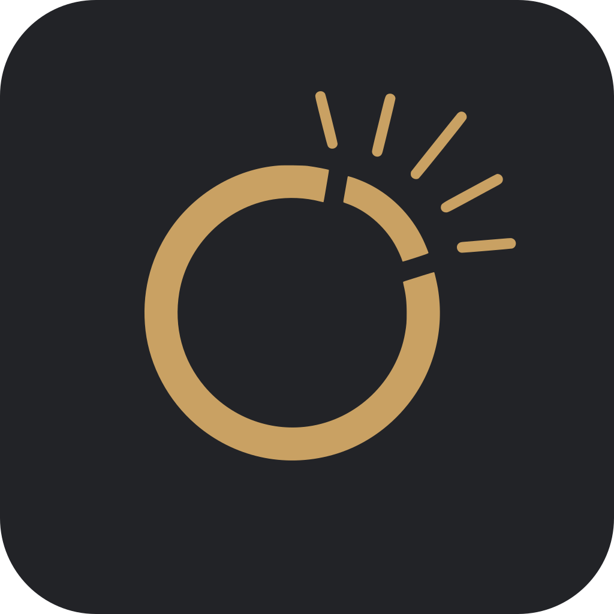
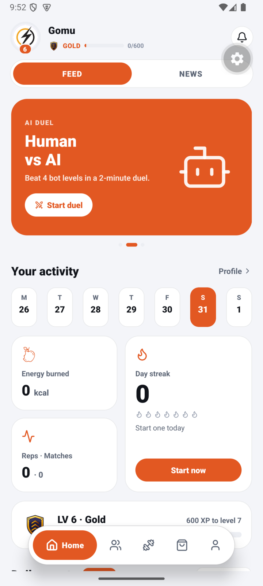
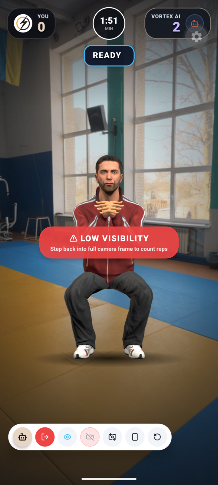
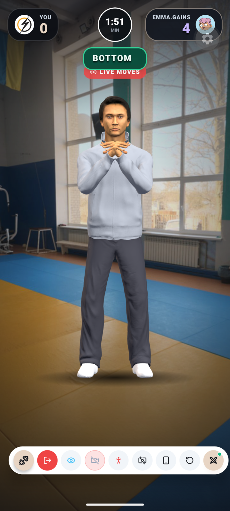
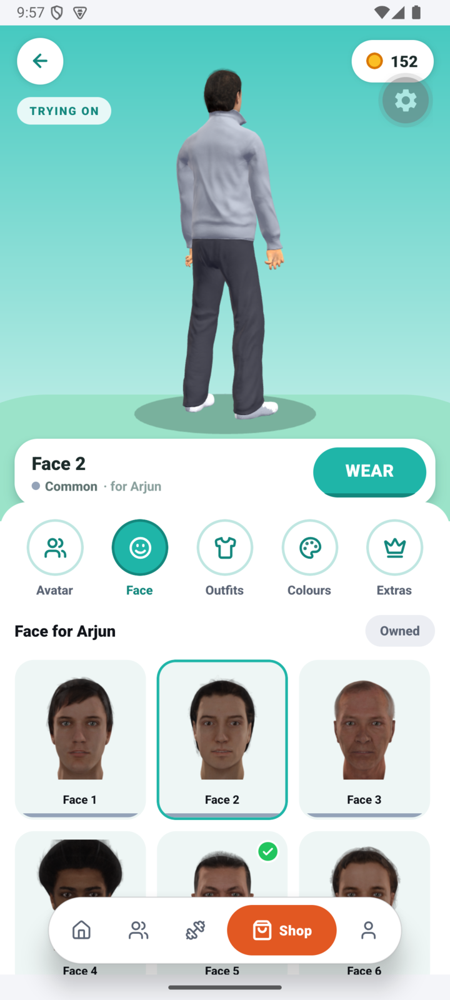
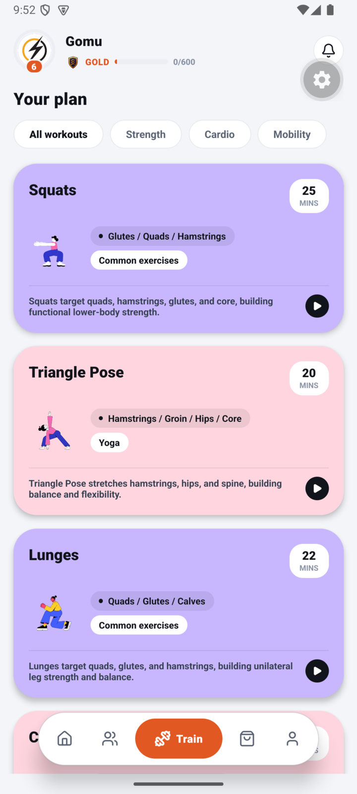

<p align="center">
  
</p>

<h1 align="center">Ojas — AI Workout & Fitness Battles</h1>

<p align="center">
  <b>A smart mobile fitness app that uses your phone's camera to track your workouts in real time, count your reps, check your posture, and let you battle friends or AI.</b>
</p>

<p align="center">
  
</p>

---

## App Features

### 1. AI Workout Coach (Camera Tracking)
- Uses your mobile camera to track your movements in real time.
- Automatically counts every good rep you complete.
- Gives live audio and visual form tips to keep your posture safe.
- **100% On-Device**: Camera frames never leave your phone.


---

### 2. Human vs AI Duels
- Jump into a 2-minute workout battle against an AI opponent.
- 4 difficulty levels: **Beginner**, **Intermediate**, **Advanced**, and **Pro**.
- Your rival is a full-screen 3D AI instructor that performs the exercise with you: squats, push-ups, lunges, yoga poses and more.
- Real-time calorie burn and rep comparison.

<p align="center">
  
</p>

---

### 3. AI Body Posture Scanner
- Quick 3-second full-body camera scan.
- Checks shoulder level, knee alignment, and spine straightness.
- Suggests targeted daily exercises to fix posture issues.


---

### 4. Live 1v1 Multiplayer Battles
- Real-time 2-minute battles with friends or matched players. Your rival is shown as their own 3D character, mirroring their live moves.
- Rep counters stay in sync; the player with the most clean reps (or the longest hold in yoga poses) wins.
- Wins are worth +10 rank points, draws +5, and defeats -10.

<p align="center">
  
</p>

---

### 5. Friends, Streaks & Daily Challenges
- Add fitness friends and send instant 1-tap battle invites.
- Daily workout challenges and streak counters to keep you consistent.
- Track total calories burned, workout time, and level progress.

<p align="center">
  
</p>

---

### 6. 3D Avatars & Shop
- Your 3D character is shown in Profile wearing its current outfit, hair and accessory.
- The **Shop** tab has **Avatar**, **Face**, **Outfits**, **Colours** and **Extras** sections, paid for in coins (1 coin per 10 XP). Tap any item to try it on the 3D model before buying or wearing it.
- Face and outfit models are downloaded on demand from the public `avatar-models` storage bucket, so the first view of one needs a network connection.

<p align="center">
  
</p>
- Each character keeps its own loadout. Purchases and equips are checked on the server (`purchase_avatar()`, `equip_avatar()`, `unequip_avatar_slot()`).

**Adding items (admins)** — every item is a row in `avatar_models`; upload files to the `avatar-models` bucket first.

| category | what it needs | `config` |
|---|---|---|
| `character` | `model_url` to a VRM 0.x or GLB (embedded textures, no Draco; include an `idle` clip for GLB) | `{}` |
| `outfit` (recolour) | `character_id` | `{"recolor": {"Tops": "#C2283A"}, "swatch": ["#C2283A"]}` — keys match part of a material name |
| `outfit` (mesh) | `character_id`; clothing GLB rigged to the same skeleton (same bone names) | `{"model_url": "https://…/jacket.glb", "hide": ["Tops"]}` |
| `hair` | `character_id` | `{"recolor": {"HAIR": "#3A3A46"}}` |
| `accessory` | `character_id` or NULL for every character | `{"builtin": "cap", "color": "#2A2470"}` or `{"model_url": "https://…/glasses.glb", "bone": "head", "position": [0, 0.08, 0.09]}` |

```sql
INSERT INTO public.avatar_models (id, name, description, rarity, price_coins, category, character_id, config, sort_order)
VALUES ('ojas_hoodie_violet', 'Violet Hoodie', 'Limited drop.', 'rare', 280, 'outfit', 'starter_ojas',
        '{"recolor": {"Tops": "#7C3AED"}, "swatch": ["#7C3AED", "#FFFFFF"]}', 14);
```

---

## Supported Exercises

| Exercise | What the AI Checks |
|---|---|
| **Squats** | Knee bend depth, back posture, standing lockout |
| **Push-ups** | Chest drop depth, arm extension, straight core |
| **Lunges** | Front knee angle, back knee clearance, vertical spine |
| **Crunches** | Shoulder lift angle, core contraction without neck pulling |
| **Triangle Pose** | Leg straightness, lateral hip hinge, arm reach |
| **Cobra Pose** | Chest elevation, lower back arch, neck alignment |
| **Child's Pose** | Deep hip rest, arm stretch, relaxing hold timer |
| **Sit-ups** | Torso lift angle, controlled return |
| **Tree Pose** | Standing-leg straightness, foot placement above the knee, balance hold timer |
| **Warrior II** | Front knee bend, rear leg straightness, level arm span, hold timer |

<p align="center">
  
</p>

---

## How to Start the Backend Server

The backend runs a Python FastAPI server for WebSocket multiplayer rooms and MediaPipe support.

### 1. Requirements
- Python 3.10 or higher
- pip

### 2. Install Dependencies
```bash
pip install -r backend/requirements.txt
```

### 3. Run the Server
From the project root directory:
```bash
python backend/server.py
```
The server will start on port `8000` (e.g. `http://localhost:8000`).

---

## How to Run the Mobile App

### 1. Requirements
- Node.js (v18+)
- npm or yarn
- Android phone (with USB debugging enabled) or Android Studio emulator

### 2. Install Packages
```bash
npm install
```

### 3. Setup Environment
Create a `.env` file in the project root:
```env
EXPO_PUBLIC_BACKEND_URL=https://app.codequestpro.in
CLOUDFLARE_TUNNEL_TOKEN=your_token_here
```

### 4. Start the Metro Server
```bash
npx expo start
```

### 5. Run on Connected Android Device
```bash
npx expo run:android
```

---

## Built With

| Layer | Technology |
|---|---|
| **Mobile Framework** | React Native & Expo SDK 57 |
| **Language** | TypeScript & Python |
| **AI Pose Engine** | MediaPipe Pose (On-Device GPU acceleration) |
| **Backend Framework** | FastAPI & Uvicorn |
| **Database & Auth** | Supabase (Database, Auth, Channels) |
| **Live Match Server** | WebSocket Server |
| **Icons & UI** | Lucide Icons & Custom SVG Vector Graphics |

---

## License
This project is licensed under the MIT License.
